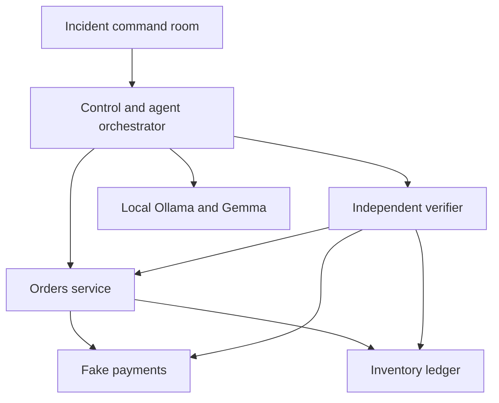

# Blackout Lab ⚡

**Break the system. Investigate the evidence. Verify the recovery.**

A local-first incident-response laboratory for a tiny commerce system, with reproducible failures, durable ledgers, local Gemma agents and an interactive incident command room.

> This is an authored toy-service laboratory. All payments are fake. Recovery results apply to these scenarios; this is not a production SRE agent.

## Quick start

```bash
python -m venv .venv
source .venv/bin/activate
# Windows PowerShell: .venv\Scripts\Activate.ps1
python -m pip install -e '.[test]'
python -m blackout serve
```

Open **http://127.0.0.1:8080**, choose a scenario, keep **Runbook** selected, and launch an incident. This reference mode works without Ollama and does not make AI calls.

## What is implemented

- Orders, Payments and Inventory services with durable SQLite WAL stores.
- A checkout saga with durable intents, fake idempotent captures and inventory reservations.
- Three repeatable faults, each confined to a new run namespace.
- Runbook, single-agent and five-role multi-agent response strategies.
- Actual local Ollama calls with schema-validated outputs and allowlisted recovery actions.
- Independent verification of six accounting/availability invariants.
- A live dashboard with topology, event timeline, agent states, run history, replay and evidence downloads.
- A Docker Compose deployment with separate processes and real HTTP service calls.
- OpenTelemetry spans and optional OTLP/HTTP export, plus persisted local events.
- A benchmark CLI recording recovery rate, wall time, model failures and action failures.

## Scenarios

| Scenario | Failure | Recovery target |
| --- | --- | --- |
| The missing order | Payment capture succeeds, order writer fails | Restore order writer and replay durable intents without another charge |
| Inventory déjà vu | A duplicate inventory message bypasses idempotency | Restore the guard, remove extra reservations and return their stock |
| Payment blackout | Capture endpoint rejects all requests | Restore availability and replay waiting checkout intents |

The lab sends two checkout intents (quantities 2 and 1) against an initial stock of 20 units. A recovered run has two orders, two captures, two reservations and 17 remaining units.

## Strategies

| Mode | Behavior | Requires Ollama |
| --- | --- | --- |
| `runbook` | Executes the authored reference plan | No |
| `single` | One model call investigates and chooses a recovery plan | Yes |
| `multi` | Commander → observer → investigator → recovery engineer → verifier | Yes |

Specialists share evidence and previous findings, using the same configured model sequentially. The recovery agent selects real bounded actions; these are executed against the toy services and independently checked. The verifier agent narrates the measured outcome but cannot change it. There is **no silent runbook fallback** if inference fails.

## Enable local Gemma 4

Install current Ollama from its official source, start it, then:

```bash
ollama pull gemma4:e4b
export OLLAMA_BASE_URL=http://127.0.0.1:11434
export BLACKOUT_MODEL=gemma4:e4b
python -m blackout serve
```

PowerShell:

```powershell
$env:OLLAMA_BASE_URL="http://127.0.0.1:11434"
$env:BLACKOUT_MODEL="gemma4:e4b"
python -m blackout serve
```

Select **Multi-agent · local Gemma** in the dashboard. Model calls use temperature 0, an 8192-token context request, a 900-token output budget and a 90-second HTTP timeout per call. Invalid JSON, invalid actions, analysis-role action attempts and unavailable models are recorded as failures. There is no generated-code or shell execution.

Context and quantization affect VRAM use. On an RTX 4060 8 GB, partial CPU offloading may be needed; this project does not promise full GPU residency or a particular latency. Model name and endpoint can be changed at startup. Local `.env` files are not automatically loaded by Python; export settings explicitly. Compose reads `.env` for substitution.

## Distributed Docker deployment

```bash
docker compose up --build
```

Only the control UI is published to the host, on **127.0.0.1:8080**. Orders, Payments and Inventory communicate on the Compose network and have separate persistent volumes. A single control worker owns its background run queue.

The default container Ollama endpoint is `http://host.docker.internal:11434`. Linux uses a host-gateway mapping. Ollama must be reachable from the container; a host daemon bound strictly to 127.0.0.1 may not accept it. If that setup is unavailable, use Runbook mode or run Python locally with Ollama. Do not expose an unauthenticated Ollama service publicly to make it reachable.

`BLACKOUT_INTERNAL_TOKEN` can protect service mutation endpoints in a custom deployment, but must be set identically on control and every service. The bundled Compose network has no host-published service endpoints. There is no user authentication; this is a loopback development tool, not an internet-facing deployment.

## Architecture



In local mode, three service objects use separate database files in one process. Compose replaces the transport with HTTP and runs each service in its own container. Both use the same domain logic. OpenTelemetry context is propagated across HTTP; persisted events include a laboratory correlation ID and span trace ID.

## What counts as recovery

All of these must pass:

1. Every durable checkout intent has a committed order.
2. Captures match the order keys, quantities and integer amounts.
3. Every order has exactly one matching inventory reservation.
4. Remaining stock equals initial stock minus committed order quantities.
5. Available stock plus the reservation ledger conserves initial inventory.
6. All injected fault switches are disabled.

A run ends `recovered` only if the real checks pass. Otherwise it is `unresolved`, or `failed` if infrastructure prevented the experiment completing. A process restart marks unfinished persisted runs `interrupted` rather than pretending they finished. Failed model narrative is visible even when deterministic checks pass.

## Benchmarking

```bash
python -m blackout benchmark --mode runbook --trials 3 --output runbook.json
python -m blackout benchmark --mode single --trials 3 --output single.json
python -m blackout benchmark --mode multi --trials 3 --output multi.json
```

Run each mode on the same machine/model and compare `recovery_rate`, `duration_ms`, `agent_calls`, `agent_failures`, `actions_attempted` and `actions_failed`. Each trial uses fresh run data. Runbook is a known-solution reference, **not AI performance evidence**. No claim that multi-agent outperforms single-agent is made without measured results.

The cases are deliberately small. Snapshots omit the scenario label and fault configuration before they are sent to agents, but authored error messages can reveal the fault boundary. This is an introductory benchmark, not a blind diagnosis challenge or a general incident corpus.

## Observability

Events are stored locally in SQLite even without a collector. For OTLP/HTTP export, set a collector base URL **before startup**:

```bash
export OTEL_EXPORTER_OTLP_ENDPOINT=http://127.0.0.1:4318
python -m blackout serve
```

The exporter appends `/v1/traces`. A collector is optional and is not bundled in the default Compose deployment. Export is batch-based; a missing collector may emit exporter errors but does not define the accounting verdict.

## API

| Method | Path | Purpose |
| --- | --- | --- |
| GET | `/healthz` | Process health and role |
| GET | `/api/scenarios` | Scenario catalog |
| GET | `/api/config` | Model and deployment mode |
| POST | `/api/runs` | Create and enqueue a run |
| GET | `/api/runs` | Recent 50 runs |
| GET | `/api/runs/{id}` | Persisted status and final report |
| GET | `/api/runs/{id}/events?after=0` | Incremental control/agent timeline |
| GET | `/api/runs/{id}/state` | Actual service snapshots and invariant checks |
| GET | `/api/runs/{id}/report` | Download a completed report |

```bash
curl -X POST http://127.0.0.1:8080/api/runs \
  -H 'Content-Type: application/json' \
  -d '{"scenario":"orphaned-payment","mode":"runbook"}'
```

The control queue accepts at most four outstanding runs with two concurrent workers. Use one Uvicorn worker. Distributed SQLite operations are not a cross-service transaction; partial saga progress is intentionally visible and recovery replays by idempotency key.

## Project map

```text
blackout/api.py          Control API, service API and bounded background queue
blackout/services.py     Commerce domain operations and authored faults
blackout/db.py           Transactional SQLite stores and durable events
blackout/transport.py    In-process and real HTTP transports
blackout/agents.py       Typed Gemma specialist prompts and action schema
blackout/lab.py          Injection, evidence hearing, recovery and reports
blackout/verify.py       Independent accounting invariants
blackout/telemetry.py    OpenTelemetry spans and optional OTLP export
blackout/static/         Responsive incident command room
blackout/__main__.py     Server and benchmark CLI
tests/                  Domain, API, orchestration and distributed tests
docs/                   Architecture and benchmark records
```

## Validation and limitations

Run `python -m pytest -q`. CI installs the package and tests Python 3.11–3.14. Validation details and measured reference results are recorded in [docs/VALIDATION.md](docs/VALIDATION.md).

The prototype has no real money, arbitrary fault execution, generated patches, production credentials, infrastructure control or automatic deployment privileges. The tiny catalog is intentional. UI replay replays the persisted **timeline**, not a second execution of the distributed system. Wall time includes inference and orchestration overhead, not production MTTR.

## Roadmap

- More fault classes, delayed messages and explicit causal hypotheses.
- Compensation/refunds and out-of-stock sagas.
- Exportable OTLP evidence bundles and collector deployment profiles.
- Larger blind scenario suites and measured agent ablations.
- Repeated-trial statistical comparisons and resource-use measurements.

## References

- [Ollama structured outputs](https://docs.ollama.com/capabilities/structured-outputs)
- [Gemma 4 on Ollama](https://ollama.com/library/gemma4)
- [OpenTelemetry Python instrumentation](https://opentelemetry.io/docs/languages/python/instrumentation/)

MIT License · Mina Ibrahim
